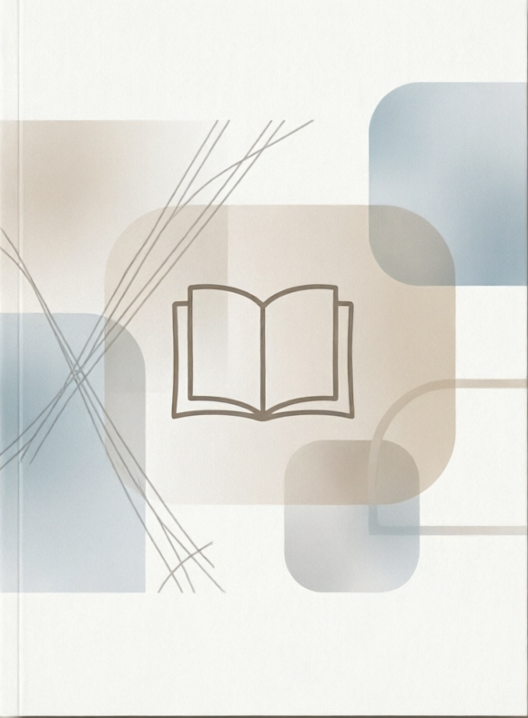

  <picture>
    <source media="(prefers-color-scheme: dark)" srcset="./img/books-header-dark.avif">
    <source media="(prefers-color-scheme: light)" srcset="./img/books-header-light.avif">
    
  </picture>

 

  

    <i>Una biblioteca de ideas, conocimientos y descubrimientos.</i>
  

  
  

---

## La biblioteca

Un espacio para recopilar, organizar y conectar los conocimientos que voy adquiriendo a través de libros técnicos y otras lecturas relacionadas con la tecnología, la ingeniería y el pensamiento.

Aquí no encontrarás los libros originales, sino **notas, conceptos, reflexiones y aprendizajes** que merece la pena conservar y consultar en el futuro.

---

## Catálogo

| Colección                                                | Descripción                                               |
| :------------------------------------------------------- | :-------------------------------------------------------- |
| [Tecnología y desarrollo](#-tecnología-y-desarrollo)     | Programación, software, arquitectura y sistemas.          |
| [Ingeniería y sistemas](#-ingeniería-y-sistemas)         | Electrónica, automatización, robótica y control.          |
| [Pensamiento y divulgación](#-pensamiento-y-divulgación) | Ideas, ciencia, pensamiento crítico y otras perspectivas. |

---

## Tecnología y desarrollo

Libros sobre programación, arquitectura de software, sistemas y herramientas tecnológicas.

<table>
  <tr>
    <td width="33%" align="center" valign="top">
      
      <h3>Nombre del libro</h3>
      Nombre del autor
      

        <a href="https://example.com">🌐 Web oficial</a>
         
        <a href="https://example.com">🛒 Comprar libro</a>
      

      

      <a href="./libros/nombre-del-libro/">
        📖 <b>Mis apuntes</b>
      </a>
    </td>
    <td width="33%" align="center" valign="top">
      
      <h3>Nombre del libro</h3>
      Nombre del autor
      

        <a href="https://example.com">🌐 Web oficial</a>
         
        <a href="https://example.com">🛒 Comprar libro</a>
      

      

      <a href="./libros/nombre-del-libro/">
        📖 <b>Mis apuntes</b>
      </a>
    </td>
    <td width="33%" align="center" valign="top">
      
      <h3>Nombre del libro</h3>
      Nombre del autor
      

        <a href="https://example.com">🌐 Web oficial</a>
         
        <a href="https://example.com">🛒 Comprar libro</a>
      

      

      <a href="./libros/nombre-del-libro/">
        📖 <b>Mis apuntes</b>
      </a>
    </td>
  </tr>

</table>

---

## Ingeniería y sistemas

Lecturas sobre electrónica, automatización industrial, robótica, control y sistemas complejos.

<table>
  <tr>
    <td width="33%" align="center" valign="top">
      Próximamente
    </td>
    <td width="33%" align="center" valign="top">
      Próximamente
    </td>
    <td width="33%" align="center" valign="top">
      Próximamente
    </td>
  </tr>
</table>

---

## Pensamiento y divulgación

Libros que ayudan a comprender mejor el mundillo, explorar nuevas perspectivas y desarrollar el pensamiento crítico.

<table>
  <tr>
    <td width="33%" align="center" valign="top">
      Próximamente
    </td>
    <td width="33%" align="center" valign="top">
      Próximamente
    </td>
    <td width="33%" align="center" valign="top">
      Próximamente
    </td>
  </tr>
</table>

---

## Sobre los apuntes

Cada libro puede incluir una selección de materiales para facilitar el estudio y conservar lo aprendido:

- **Ficha de lectura:** información de la obra, contexto e idea principal.
- **Notas por capítulos:** conceptos fundamentales, explicaciones y ejemplos.
- **Síntesis:** las ideas que considero más importantes.
- **Preguntas de repaso:** para comprobar lo aprendido.
- **Conexiones:** relaciones con otros libros, conocimientos o proyectos.

No todos los libros necesitan el mismo nivel de detalle. La estructura se adapta a la naturaleza de cada obra y a lo que merece la pena conservar.

## Sobre las fuentes

Los apuntes contienen explicaciones, reflexiones y aprendizajes personales a partir de las obras citadas. Su objetivo es facilitar el estudio y compartir conocimiento, no sustituir las publicaciones originales.

Los libros y demás materiales citados pertenecen a sus respectivos autores y titulares de derechos. Las citas y los materiales de terceros se identifican cuando corresponde.

---

  
<i>
    Esto es una biblioteca.

  Si necesitas que te preste un libro, puedes escribirme a [contacto](mailto:work.alias.unsaved790@passmail.net).

  **Atentamente,**  
  El bibliotecario.
  </i>

